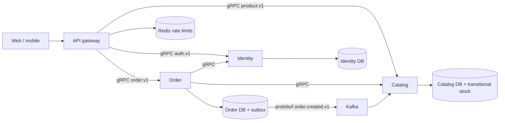

# Workspace architecture

The repository root is the `ecommerce/` root from the proposed layout. It uses
npm workspaces and Turborepo with one committed `package-lock.json`.

`contracts/proto/<domain>/v1/` owns synchronous contracts. `contracts/events/`
owns asynchronous schemas. `packages/proto-gen` supplies generated TypeScript
types, runtime loaders and protobuf event serialization. Consumers import
packages rather than sibling service source or another service's Prisma client.

| Package         | Responsibility                                                              |
| --------------- | --------------------------------------------------------------------------- |
| `proto-gen`     | Generated gRPC types and contract loading independent of process cwd        |
| `grpc-kit`      | Awaited server binding, unary error mapping, retries, health and shutdown   |
| `messaging-kit` | Kafka construction, event codecs/validation, outbox port and DLQ forwarding |
| `observability` | Pino, correlation IDs, Prometheus metrics and optional OTel bootstrap       |
| `config`        | Shared Zod environment parsing and bounded port validation                  |
| `errors`        | AppError/ApiError and HTTP/gRPC status mapping                              |
| `common`        | Existing Express/Redis helpers and compatibility exports during extraction  |

`common` reexports extracted implementations so existing imports keep working.
New code should use the owning package. It does not own duplicate implementations.

`edge/api-gateway` handles REST authentication and read aggregation through typed
gRPC clients, fixed deadlines, Redis-backed limits, and correlation propagation.
It checks order ownership using the validated token identity; caller-supplied
user IDs never select another customer's orders. Optional BFF directories reserve
client-specific aggregation boundaries without creating idle services.

The gateway exposes the initial endpoints listed in [API.md](API.md). Existing
service REST command routes remain available on their own development ports
while they are migrated to gRPC. GraphQL is optional and has not been introduced.

The six new service workspaces expose internal operations listeners. Liveness is
200 and business readiness is 503. Inventory and payment additionally have v1 RPC
contracts; their handlers are not implemented. Search and notification are intended
as event consumers; they do not expose public business endpoints yet.

Catalog still owns the existing stock column and OrderCreated consumer. Moving
stock to inventory requires a data migration, reservation expiry, compensation,
and a saga in order-service. Payment currently retains the legacy order payment
behavior. Do not interpret either as an implemented inventory/payment saga.

Each existing service owns its database and baseline migration. New service
databases, Redis cart state, provider integrations, OpenSearch projections, and
S3/CDN operations are defined responsibilities rather than simulated features.
